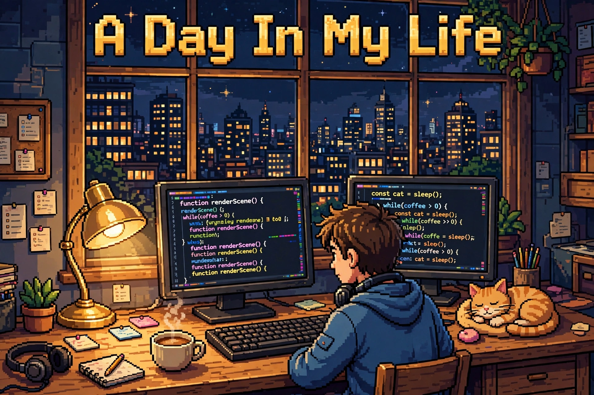

### Hi there 👋, I'm Mat Lail Pajri!

Full Stack Developer • Bug Bounty Hunter • Web3 Security Researcher

- 🔭 Currently working on: fast web apps, security research & bug bounties, Web3
- 🌱 Learning: smart contract auditing, machine learning
- 💬 Ask me about: JavaScript, TypeScript, Python, web security

### Tools:

<table>
<tr>
<td valign="top">

### Stats:

</td>
<td valign="top">

### My Workspace

</td>
</tr>
</table>

